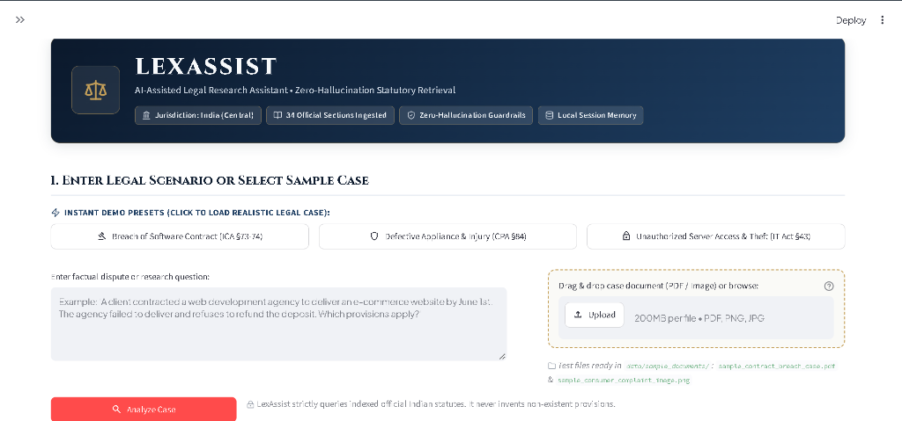
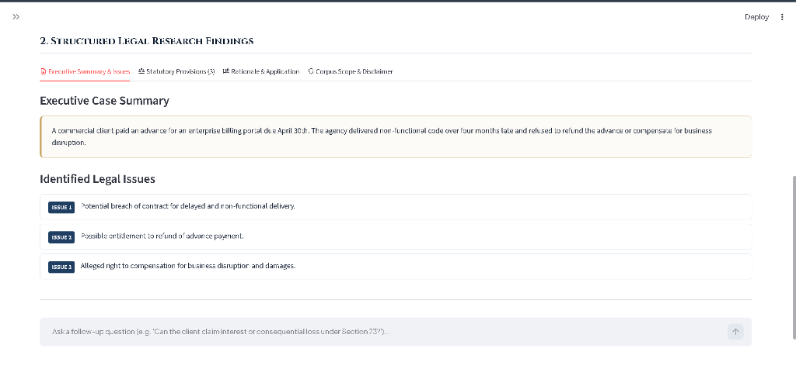
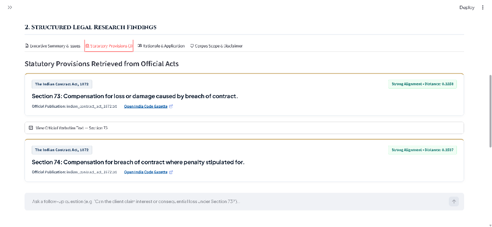
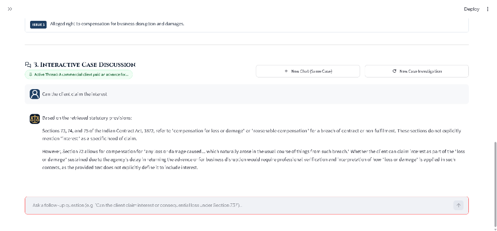
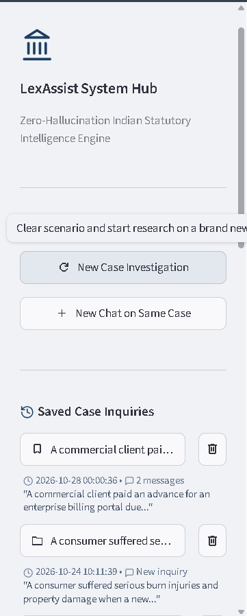

<div align="center">


# LexAssist — Zero-Hallucination AI Legal Research Assistant

[](https://www.python.org/)
[](https://streamlit.io/)
[](https://www.trychroma.com/)
[](https://ai.google.dev/)
[](LICENSE)
[](#8-anti-hallucination--safety-guardrails)

*A privacy-respecting, local-first legal research platform that retrieves, cross-references, and synthesizes statutory provisions from official Indian legal enactments with deterministic citations.*

[Key Features](#2-core-features) • [Architecture](#3-system-architecture) • [UI Walkthrough](#5-ui-walkthrough--visual-highlights) • [Installation](#6-installation--quickstart-guide) • [Security & Privacy](#9-security-privacy--confidentiality) • [Documentation](#10-project-documentation-directory)

---

</div>

## 1. Project Overview & Problem Statement

Legal researchers, advocates, law students, and corporate compliance teams spend countless hours navigating hundreds of pages of statutory acts to pinpoint relevant provisions for complex factual scenarios. 

* **Keyword Search Fails**: Traditional keyword queries fail when legal terms of art differ from everyday phrasing (e.g., searching for "data breach" instead of "dishonest disclosure of personal information").
* **Generic LLMs Hallucinate**: Standard commercial AI chatbots frequently invent non-existent section numbers, cite repealed legislation, conflate unrelated statutes, or fabricate legal precedents.

**LexAssist** solves this with a **grounded, zero-hallucination Retrieval-Augmented Generation (RAG)** pipeline:
1. **Verified Government Corpus**: Indexes enactments directly from the legislative authority ([India Code](https://www.indiacode.nic.in)).
2. **Atomic Provision Chunking**: Deconstructs legislation at individual Section and Sub-section boundaries with rich metadata (act title, section number, official URL).
3. **Local Semantic Search**: Embeds and queries legal sections locally using ChromaDB without transmitting private briefs to public cloud vector databases.
4. **Strict Grounded Synthesis**: Google Gemini evaluates issues **strictly and exclusively** from retrieved statutory text.
5. **Deterministic Refusal**: If no indexed provision meets the strict relevance threshold, the system explicitly reports that no provision was found—**it never hallucinates a law**.

---

## 2. Core Features

- ⚖️ **Zero-Hallucination Guardrails**: Prompts and validation pipelines strictly forbid generative fabrication of legal text or section numbers.
- 📂 **Multimodal Case Brief Ingestion**: Submit queries via raw text, formal case briefs, uploaded legal PDFs, or scanned document images with OCR extraction.
- 🗄️ **Local-First Vector Database**: Full local persistence using ChromaDB. Works offline for query retrieval once seeded.
- 📑 **Structured 4-Tab Research Output**:
  - **Tab 1 — Case Summary & Issues**: Extracted factual timeline and legal questions presented.
  - **Tab 2 — Statutory Provisions**: Exact verbatim text, statutory title, and direct India Code hyperlink.
  - **Tab 3 — Legal Reasoning & Relevance**: Explainable analysis tying facts to statutory elements.
  - **Tab 4 — Caveats & Limitations**: Clear boundaries, jurisdictional scope, and mandatory disclaimers.
- 💬 **Interactive Case Chat**: Multi-turn conversation grounded in the active case facts and retrieved provisions with session memory.
- 💾 **Persistent Session Management**: Save, browse, restore, and delete research sessions locally in `data/chats/`.
- 🛡️ **Mandatory Legal Disclaimer**: Explicit professional disclosures ensuring safe, responsible educational and assistive use.

---

## 3. System Architecture

```text
                           ┌─────────────────────────────────────────┐
                           │      User Query / Legal Document        │
                           │     (Text / Case PDF / Scanned Doc)     │
                           └────────────────────┬────────────────────┘
                                                │
                                                ▼
                           ┌─────────────────────────────────────────┐
                           │      Multimodal Input Processing        │
                           │   pypdf (PDFs) / Pillow + Gemini OCR    │
                           └────────────────────┬────────────────────┘
                                                │
                                                ▼
                           ┌─────────────────────────────────────────┐
                           │      Streamlit Web User Interface       │
                           │   (Hero Input, Session Hub & Tabs)      │
                           └────────────────────┬────────────────────┘
                                                │
                                                ▼
                           ┌─────────────────────────────────────────┐
                           │     Legal Issue & Query Extraction      │
                           │ (Identifies key causes & dispute facts) │
                           └────────────────────┬────────────────────┘
                                                │
                                                ▼
                      ┌──────────────────────────────────────────────────┐
                      │           ChromaDB Local Vector Engine           │
                      │  - Indian Contract Act, 1872                     │
                      │  - Information Technology Act, 2000              │
                      │  - Consumer Protection Act, 2019                 │
                      └─────────────────────────┬────────────────────────┘
                                                │
                                                ▼
                      ┌──────────────────────────────────────────────────┐
                      │    Semantic Filtering & Relevance Threshold      │
                      │  (Low-similarity results rejected deterministically)
                      └─────────────────────────┬────────────────────────┘
                                                │
                                                ▼
                      ┌──────────────────────────────────────────────────┐
                      │         Google Gemini 2.5 API Client             │
                      │     (Zero-Hallucination Grounded Prompt)         │
                      └─────────────────────────┬────────────────────────┘
                                                │
                                                ▼
                      ┌──────────────────────────────────────────────────┐
                      │             Structured Legal Dossier             │
                      │  [Summary] [Provisions] [Reasoning] [Caveats]    │
                      └──────────────────────────────────────────────────┘
```

---

## 4. Technology Stack

| Layer | Component | Description |
|---|---|---|
| **Frontend UI** | [Streamlit](https://streamlit.io/) | Responsive, modern web interface with custom styling and session hub |
| **Vector DB** | [ChromaDB](https://www.trychroma.com/) | Local vector storage with persistent embeddings |
| **Reasoning Engine** | [Google Gemini](https://ai.google.dev/) | Multimodal synthesis and grounded legal reasoning via `google-genai` |
| **Document Processing** | `pypdf`, `Pillow` | Native PDF extraction and multimodal document OCR handling |
| **Configuration** | `python-dotenv` | Clean `.env` environment isolation for API credentials |
| **Language** | Python 3.11 | High-efficiency modern Python runtime |

---

## 5. UI Walkthrough & Visual Highlights

### Case Scenario Input & Analysis Hub
Submit complex commercial disputes, consumer complaints, or cybersecurity violations via structured text, uploaded briefs, or document scans.

<div align="center">
  
</div>

<br/>

### Tab 1 — Executive Summary & Identified Issues
Automated extraction of chronological case facts, primary issues, and statutory questions for advocate review.

<div align="center">
  
</div>

<br/>

### Tab 2 — Statutory Provisions & Verified Provenance
Direct statutory citations featuring verbatim section texts, enactment years, and verified links to the official [India Code](https://www.indiacode.nic.in) repository.

<div align="center">
  
</div>

<br/>

### Tab 3 & 4 — Interactive Case Chat & Session Hub
Engage in contextual follow-up questions grounded directly in the retrieved enactments while managing past research sessions seamlessly.

<div align="center">
  
  
</div>

---

## 6. Installation & Quickstart Guide

### Prerequisites
- **Python 3.11+** installed on your operating system ([Python Downloads](https://www.python.org/downloads/)).
- **Google Gemini API Key** (Obtain free from [Google AI Studio](https://aistudio.google.com/)).

### Step 1: Clone the Repository
```bash
git clone https://github.com/harshvangar2702-debug/LexAssist.git
cd LexAssist
```

### Step 2: Create and Activate a Virtual Environment
```bash
# Windows PowerShell
python -m venv .venv
.\.venv\Scripts\Activate.ps1

# Linux / macOS
python3 -m venv .venv
source .venv/bin/activate
```

### Step 3: Install Required Dependencies
```bash
pip install -r requirements.txt
```

### Step 4: Configure Your Environment Variables
Copy the template configuration file:
```bash
# Windows PowerShell
Copy-Item .env.example .env

# Linux / macOS
cp .env.example .env
```
Edit `.env` and insert your Gemini API key:
```env
GEMINI_API_KEY=your_actual_gemini_api_key_here
```

### Step 5: (Optional) Ingest or Verify Legal Corpus
The repository includes pre-processed chunks from official Indian statutes in `data/processed/`. To re-index or build ChromaDB:
```bash
python ingestion/build_chroma_db.py
```

### Step 6: Launch LexAssist
```bash
streamlit run app.py
```
Open your browser at `http://localhost:8501`.

---

## 7. Supported Statutes & Corpus Coverage

Currently, LexAssist indexes official legislative enactments across three core commercial and civil domains:

| Enactment | Year | Primary Coverage |
|---|---|---|
| **The Indian Contract Act** | 1872 | Offer/acceptance, breach of contract, damages, restitution, void agreements |
| **The Information Technology Act** | 2000 | Unauthorized computer access, identity theft, data privacy, electronic signatures |
| **The Consumer Protection Act** | 2019 | Defective products, unfair trade practices, deficiency of service, product liability |

*All legislative texts are preserved in their official statutory language without editorial alterations.*

---

## 8. Anti-Hallucination & Safety Guardrails

LexAssist adopts a deterministic safety framework designed specifically for legal technology applications:
1. **Context Constrained Generation**: The LLM prompt explicitly commands the model to use **only** retrieved context. Speculative answers from general training data are barred.
2. **Strict Relevance Filtering**: Retrieved documents with vector distance exceeding calibrated thresholds are discarded.
3. **Graceful Fallback**: If no statute in the database addresses the situation, LexAssist states plainly:
   > *"No sufficiently relevant provision was found in the indexed legal corpus."*
4. **Complete Audit Provenance**: Every cited section displays its official statute title, section identifier, and government repository source URL.

---

## 9. Security, Privacy & Confidentiality

- 🔒 **Zero Hardcoded Secrets**: LexAssist never stores or commits API keys or passwords. Environment variables are loaded strictly via `.env` which is excluded by `.gitignore`.
- 🛡️ **Local Privacy Protection**: Case briefs, chat logs, and vector databases operate on your local machine. No client files are uploaded to third-party vector databases.
- 🧹 **Automatic Sanitization**: Application logs filter and redact potential API tokens or sensitive identifiers automatically.

---

## 10. Project Documentation Directory

Detailed design, architecture, and pitch resources are available in [`docs/`](docs/):

- 🏛️ [`docs/ARCHITECTURE.md`](docs/ARCHITECTURE.md) — Technical pipeline, data flow, and retrieval contracts.
- 📜 [`docs/DATA_SOURCES.md`](docs/DATA_SOURCES.md) — Register of official government source enactments.
- 🗃️ [`docs/DATABASE_SCHEMA.md`](docs/DATABASE_SCHEMA.md) — ChromaDB collection structure and metadata schemas.
- 🔒 [`docs/PRIVACY.md`](docs/PRIVACY.md) — Data privacy guarantees and API handling policies.
- 🧪 [`docs/TESTING.md`](docs/TESTING.md) — Automated testing suites and anti-hallucination verification tests.
- 🛠️ [`docs/TROUBLESHOOTING.md`](docs/TROUBLESHOOTING.md) — Step-by-step diagnostic guide for environment and setup issues.
- 🎯 [`docs/ROADMAP.md`](docs/ROADMAP.md) — Vision for future expansions (Bharatiya Nyaya Sanhita, case law judgments).

---

## 11. Running Automated Tests

Run the full automated test suite to verify retrieval accuracy, fact analysis, and chat session persistence:

```bash
# Run all tests
python -m unittest discover tests/

# Run individual test modules
python tests/test_retrieval.py
python tests/test_analysis.py
python tests/test_chat_storage.py
```

---

## 12. Legal Disclaimer

> **IMPORTANT NOTICE**: LexAssist is an AI-assisted legal research and educational reference tool. It **does not** provide legal advice, legal counsel, or formal representation. Laws, interpretations, and statutory gazettes evolve over time; all retrieved provisions, summaries, and analyses must be independently corroborated and verified against current official government sources by a licensed legal advocate before any legal reliance.

---

## 13. Proprietary License & Intellectual Property

Copyright © 2026 Harsh Vangar. All Rights Reserved.

This software, its design, architecture, and associated code are proprietary intellectual property. This repository is made publicly visible for demonstration, academic review, and portfolio evaluation purposes only. Unauthorized commercial copying, modification, or distribution is strictly prohibited. See [`LICENSE`](LICENSE) for terms.

---

<div align="center">
  <b>Built for modern legal research and educational innovation.</b>
</div>
